# Harvestly

Harvestly is a small farm manager app for Android: fields, crops, hens and eggs,
tasks and money. It is a practice app for mobile test automation with Appium,
not a real product. Every element a test needs has a stable test ID.

## Screenshots

| Screen | Light | Dark |
| --- | --- | --- |
| Login |  | 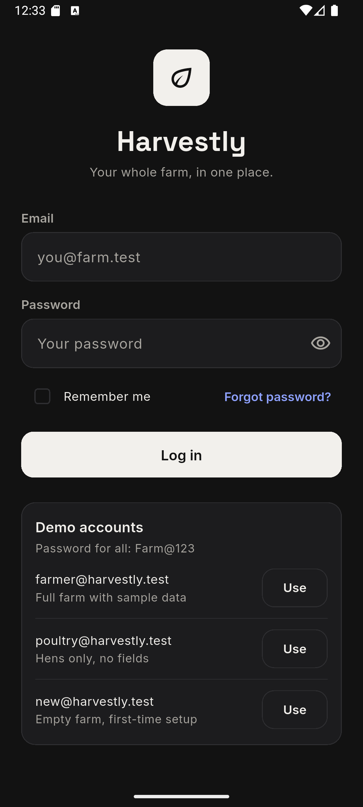 |
| Home, farmer account | 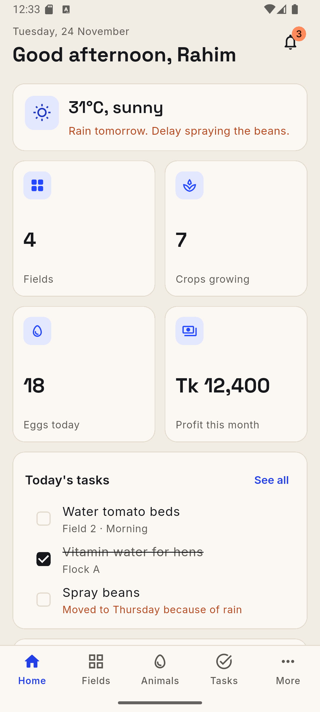 | 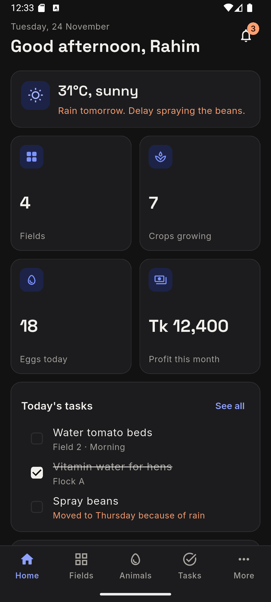 |
| Home, new account | 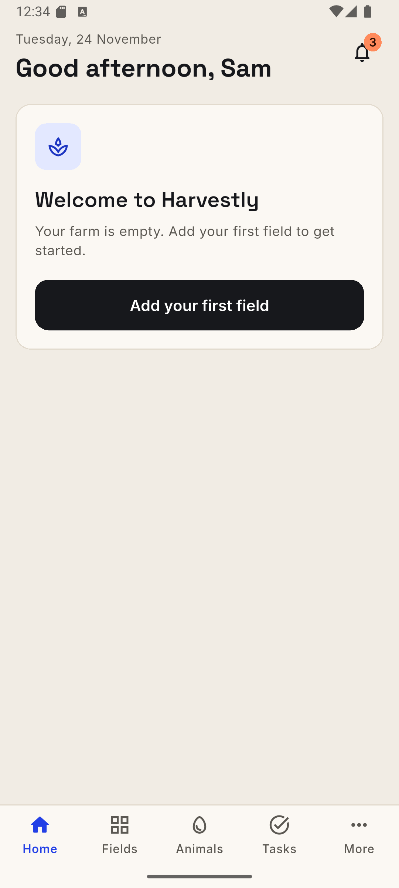 | 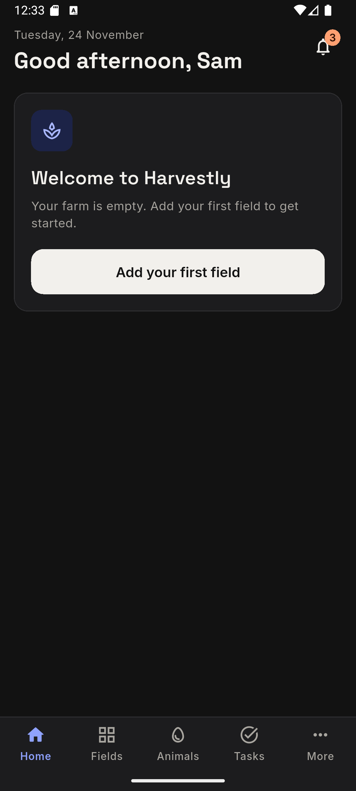 |
| More (Settings) |  |  |
| Fields list |  | 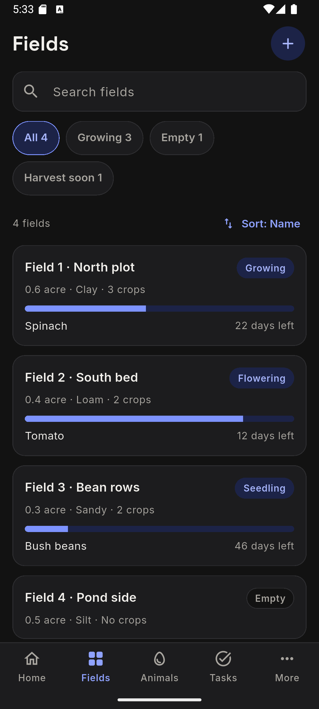 |
| Field form with errors | 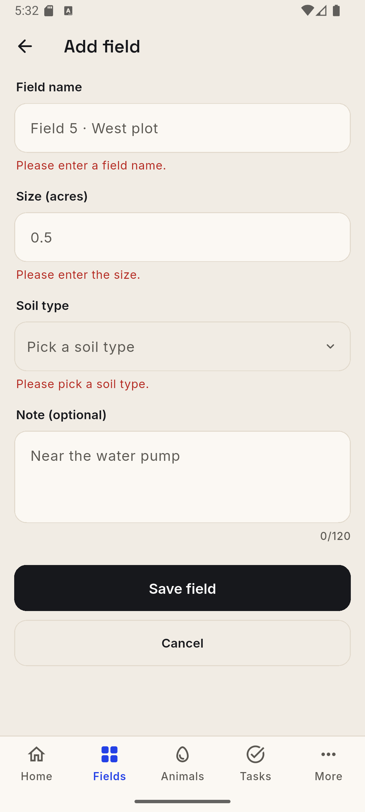 |  |
| Field detail | 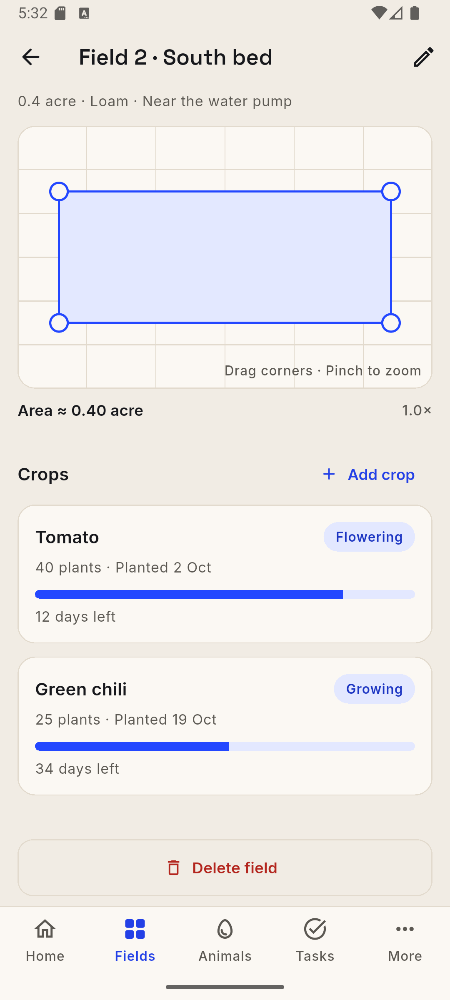 | 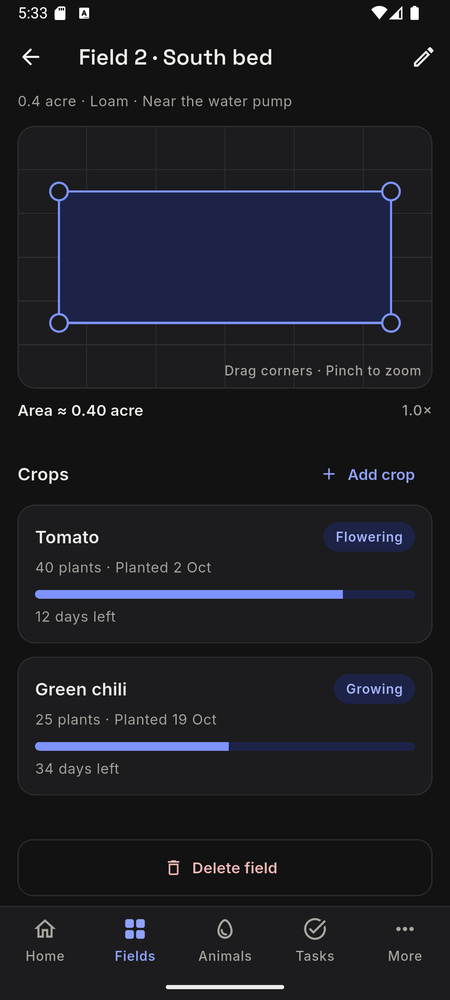 |
| Add crop | 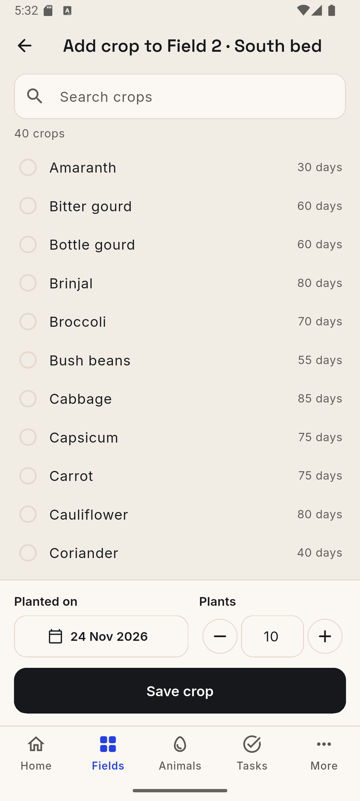 | 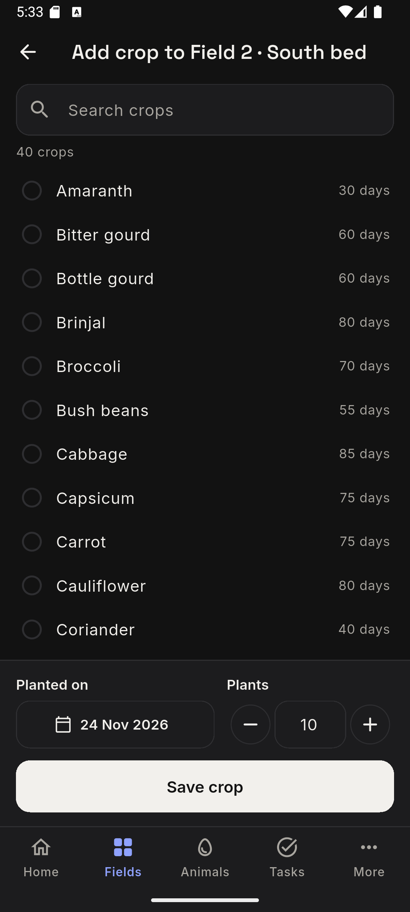 |
| Crop detail |  |  |
| Harvest dialog |  |  |

## Download the app

The newest APK is always at this link:

```
https://github.com/Yusuf-Hridoy/Harvestly-App/releases/latest/download/harvestly.apk
```

Every push to `main` builds a fresh APK and publishes it as a release, so the
link never changes. The repository is public, so the test repo can download it
without a token.

## Demo accounts

There is no server. These three accounts are built into the app. The password
for all of them is `Farm@123`. The email ignores upper and lower case and spaces
at the start or end. The password is case-sensitive.

| Email | Name | Note | Home shows |
| --- | --- | --- | --- |
| `farmer@harvestly.test` | Rahim Uddin | Full farm with sample data | Full home |
| `poultry@harvestly.test` | Nadia Akter | Hens only, no fields | Home without the harvest card |
| `new@harvestly.test` | Sam Hossain | Empty farm, first-time setup | Empty farm card |

## Fields and crops

The Fields tab holds the real data. A field has a name, a size in acres, a
soil type, an optional note and a drawn shape. A crop belongs to one field and
has a type from a list of 40, a planting date and a number of plants.

- The list can be searched by name, filtered by All, Growing, Empty or
  Harvest soon, and sorted by name, size or harvest date. A long press on a
  card offers Edit field and Delete field.
- Field detail draws the field as a four-corner shape on a grid. Drag a corner
  to move it, pinch to zoom from 1.0x to 3.0x, and the area line updates while
  you drag. The drawing is only a picture; it never changes the size you typed
  in the form.
- A crop shows its stage (Seedling, Growing, Flowering, Ready to harvest), how
  far along it is, and how many days are left. Mark as harvested asks for the
  amount in kilograms and moves the crop to Past harvests. There is no editing
  a crop yet: delete it and add it again.
- Everything is saved on the phone, one record per account, so it survives
  closing the app. There is still no backend and no network call.

## Run it yourself

Built and tested with **Flutter 3.50.1 (stable), Dart 3.14.0**.

On Windows:

1. Install Flutter. Follow the steps at <https://docs.flutter.dev/get-started/install/windows>
   and add `flutter\bin` to your PATH.
2. Install Android Studio, then open **Settings > Languages & Frameworks >
   Android SDK > SDK Tools** and install the Android SDK, the platform tools and
   the NDK. If a build says the NDK is missing, install exactly version
   `28.2.13676358`.
3. Run `flutter doctor` and fix anything it reports. Accept the Android licences
   with `flutter doctor --android-licenses`.
4. Start an Android emulator from Android Studio's Device Manager, or plug in a
   phone with USB debugging on. Minimum Android version is 7.0 (API 24).
5. In this folder, run `flutter pub get`.
6. Run `flutter run`.

To build the APK yourself: `flutter build apk --release`. The file lands in
`build/app/outputs/flutter-apk/app-release.apk`.

## For testers

Test IDs are Flutter `Semantics` identifiers. On Android they show up as the
element's `resource-id`. The full list, with the screen and element each one
belongs to, is in [test_ids.md](test_ids.md).

In Appium, set the capability `appium:disableIdLocatorAutocompletion` to `true`,
then find elements with `AppiumBy.ID`:

```python
driver.find_element(AppiumBy.ID, "login_submit_button").click()
```

Things worth knowing before you write tests:

- Tapping **Log in** waits 800 ms on purpose before the result. `login_loading_indicator`
  is in the tree during that wait. Pull to refresh on Home waits 800 ms too.
- `login_email_error_text`, `login_password_error_text` and `login_error_banner`
  are only in the tree while they are on screen.
- `app_snackbar_text` closes itself after 3 seconds.
- `home_harvest_progress_bar` sits below the fold; scroll down before looking
  for it.
- Ticked tasks live in memory only and reset when the app restarts. Fields and
  crops are saved and do survive a restart.
- **Reset demo data** on the More tab puts one account's fields and crops back
  to the starting sample. Use it between test runs instead of reinstalling. It
  leaves the other accounts, the theme and the login alone.
- Every planting date in the sample is counted back from today, so the
  days-left numbers are the same on every run.
- The crop list in Add crop is long and only the rows on screen are in the UI
  tree. Search for the crop first, then tap it.

Saved UI tree dumps for each screen are in `docs/ui-dumps/`.

## Project structure

```
lib/
  main.dart                  app start: loads saved settings, runs the app
  app/                       MaterialApp, router, colors, themes
  data/                      the 3 demo accounts, the crop catalog, the saved
                             farm data and the starting sample
  features/
    login/                   login screen and its controller
    fields/                  the Fields tab, the field form, field detail and
                             the drawn map
    crops/                   add a crop, crop detail and the harvest dialog
    shell/                   the bottom tab bar around the 5 tabs
    home/                    home screen and its cards
    coming_soon/             placeholder for Fields, Animals and Tasks
    settings/                the More tab and the theme choice
  shared/
    session/                 remember me and the logged-in account
    logic/                   today's date, crop growth and field area maths
    testing/                 the TestId wrapper and every test ID
    widgets/                 the shared snackbar
    app_info/                reads the app version from the build
assets/fonts/                Inter and Space Grotesk, with their licences
test/                        widget tests
docs/screenshots/            the screenshots above
docs/ui-dumps/               Android UI tree dumps, one per screen
```

## Roadmap

- Phase 1 - Foundation (done)
- Phase 2 - Fields and crops (done)
- Phase 3 - Animals and poultry
- Phase 4 - Tasks and reminders
- Phase 5 - Camera and diary
- Phase 6 - Money, weather and offline
- Phase 7 - Testing gym
